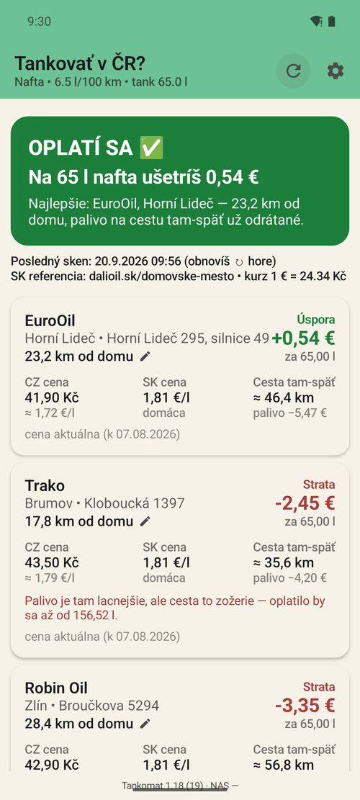
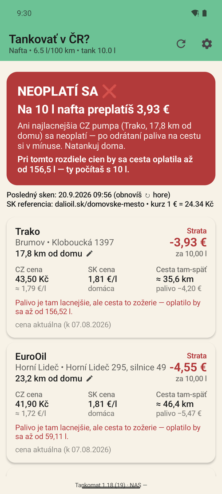
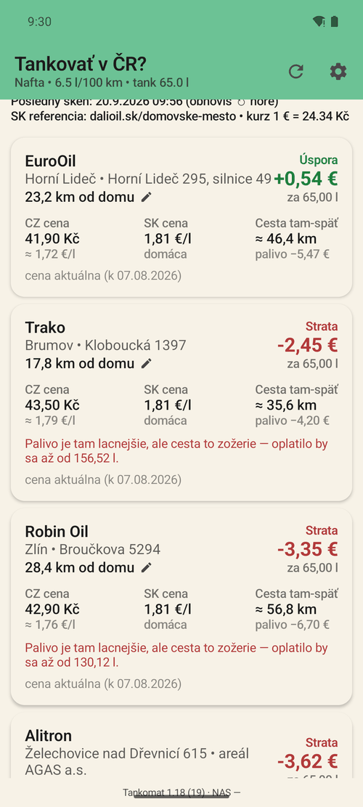
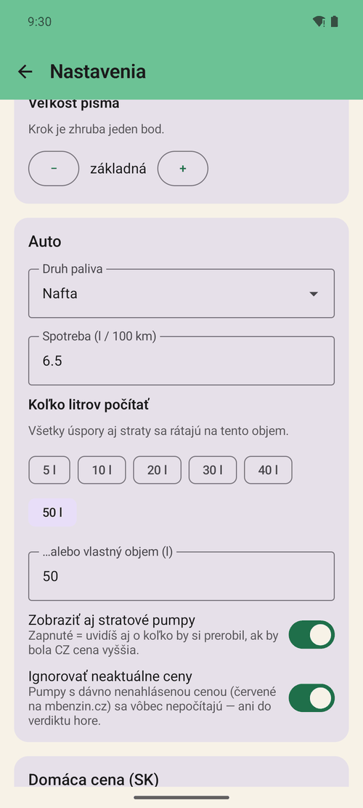

# Tankomat

**Is it worth driving across the border to fill up?** Tankomat takes fuel
prices at Czech stations near the Slovak border, compares them with the Slovak
reference price, subtracts the fuel burned on the round trip, and answers with
a number.

The top of the screen is a single verdict: green **"WORTH IT"** with the amount
saved, or red **"NOT WORTH IT"** with how much you would lose *and* the number
of litres at which the trip would start to pay off. Below it, every station is
ranked with its own saving or loss and the reason for it. A second tab,
*CZ ceny*, lists the Czech stations in range by distance, each with its price
and the day it was reported, without any calculation.

Android · Kotlin · Jetpack Compose · minSdk 26 · 69 unit tests

## What it looks like

| Worth it | Not worth it | Every station, ranked | Settings |
|---|---|---|---|
|  |  |  |  |

The red verdict does not stop at "no". It says from how many litres the same
trip would start to pay off — 156.5 l here, against the 10 l the settings are
asking about — so the answer changes with the tank, not with the mood.

The interface is Slovak; the app was written for one commute across the
Slovak-Czech border. The shots were taken from this public copy with saved test
data instead of live prices, so the kilometres are the placeholder table
described below and the Slovak reference city is `domovske-mesto`.

---

## Why this exists

Fuel is cheaper in Czechia, the border is 20–50 km away, and the usual advice
("it's cheaper over there") ignores that you burn fuel getting there. For a
10-litre top-up the trip can easily cost more than it saves — but for a full
tank it may not. The threshold depends on the distance, your consumption and
today's price gap, which is exactly the kind of arithmetic nobody does at
the pump.

## How the saving is computed

```
one_way_distance = measured road distance to that station
gross_saving     = (price_SK − price_CZ_in_EUR) × litres
trip_cost        = 2 × one_way_distance / 100 × consumption × price_SK
net_saving       = gross_saving − trip_cost
```

Vehicle depreciation, tolls and the value of your time are deliberately left
out: they are constants that shift every station by the same amount and never
change their order. If you want a margin, raise *Minimum saving to display*
in the settings.

## Where the kilometres come from

Every distance the app calculates with is a **road distance**, never a
straight line. Most come from a lookup table: addresses geocoded through
Nominatim (OpenStreetMap) and routed by car through OSRM by
[`tools/generuj_vzdialenosti.py`](tools/generuj_vzdialenosti.py). A station
that is not in the table gets a car route from home to its coordinates from
the same OSRM server, in one request for all such stations, and the result is
kept on the phone for good, so each station is asked about once. The
reference point is a fixed home address. In this public copy the table holds
made-up numbers and the home point is a round placeholder — the real ones
would give away where I live. Run the script with your own address to get
real ones.

Looking a station up is not a dictionary hit, because the key
(`name|municipality|street`) comes from the price source and is not stable.
One station was listed under municipality `Zádveřice`; four days later the same
station on the same street was listed under `Řasnice`. So the lookup goes from
precise to coarse and **always reports which level answered**
(`DistanceSource`), so an estimate never passes for a measurement:

| Level | Where the number comes from | Shown as |
|---|---|---|
| 1 | a distance you typed in for that station | as typed |
| 2 | the station in the table | measured |
| 3 | a car route to the station's coordinates (OSRM) | measured |
| 4 | the road distance to its municipality in the table | `≈ … (estimate)` |
| 5 | the road distance to the town from the settings | `≈ … (estimate)` |

If none of them answers — for example the route request failed and the town
is unknown — the station is left out of the comparison, and the screen says
how many stations that is. It never falls back to a straight line.

## Czech prices and the access key

Czech prices come from the data behind the price map on
[mbenzin.cz](https://www.mbenzin.cz). One request returns every Czech station
for one fuel, with coordinates (about 100 kB compressed). The app keeps the
stations within the search radius — 50 km **by road** by default — and works
out the municipality and street from each station's address on the site. A
straight line is used only to pick candidates out of the whole country: a road
is never shorter than the straight line, so a station outside the radius in a
straight line cannot be inside it by road.

Access goes through a personal key that mbenzin.cz issued for this app. The
condition is that the prices are credited, so the app shows *Ceny: mbenzin.cz*
under them. **The key is not in this repository.** Gradle reads `MBENZIN_KLIC`
from `nas-credentials.local` at build time (the same local file as the NAS
login below) and puts it into `BuildConfig`. It is sent only in a request
header, never in the URL or a log. If the key is missing, or the site answers
with a web page instead of data, the app says so instead of showing an empty
list.

To keep the number of requests low, a response is reused for 30 minutes, so
pressing ↻ again does not download it again. If the request works but no
station can be read from it, the repository raises `ScrapeFormatException`
and the screen says the source loaded but no prices could be read, with a retry
button. An empty screen that looks like "no results" is the one outcome worth
engineering against.

## Price freshness

The source gives only the day a price was last reported. The app turns that
into three colours and carries them through instead of flattening them:

| Last report | Colour | App behaviour |
|---|---|---|
| up to 5 days ago | green | counted normally, date on the card |
| 6–14 days ago, or no date | orange | counted, orange ⚠ with the date |
| older | red | **excluded by default**, including from the verdict; a toggle lets it back in, marked red |

## Architecture

```
sk.lukac.tankomat
├── data
│   ├── model        – CzStation, FuelType, UserConfig, StationDistances, Gps …
│   ├── remote       – HttpClient, MbenzinScraper, DalioilScraper, CnbExchangeRate, SmbUpdater
│   └── repository   – FuelRepository (parallel refresh + in-memory cache)
├── domain
│   └── SavingsCalculator
├── settings         – UserSettings (DataStore Preferences + JSON)
├── di               – AppContainer (manual DI, no Hilt)
├── viewmodel        – MainViewModel
└── ui               – navigation, screens, Material 3 theme
```

Prices are never fetched in the background except for one optional morning
refresh at 6:00, and that one runs **only on Wi-Fi** — never on mobile data,
even when the plan calls it unmetered. Everything else happens when you press
↻. The last successful scan is saved to `filesDir/last_snapshot.json`, so
opening the app shows data immediately, stamped with the time it was taken.

## Data sources

| Source | Endpoint | Notes |
|---|---|---|
| mbenzin.cz | `/Mapa-cen/data?fuel=…` | every Czech station for one fuel, JSON; personal key in a header |
| dalioil.sk | `/{city}/` | Slovak reference price, read from `` |
| Czech National Bank | `denni_kurz.txt` | CZK→EUR, pipe-delimited plain text |
| OSRM (OpenStreetMap) | `/table/v1/driving/…` | road distance to stations missing from the table; asked once per station |

## Tests

```bash
./gradlew :app:testDebugUnitTest
```

69 JVM tests, no emulator needed and no key needed. The parsers are tested
against **saved responses** in `app/src/test/resources/fixtures/` — a sample of
the mbenzin.cz map data and a dalioil.sk page — so a parser regression shows up
as a failing test rather than as an empty screen on the phone.

## Build

Requires Android Studio Koala (2024.1.1) or newer and JDK 17. The Gradle
wrapper (8.10.2) is committed, so:

```bash
./gradlew :app:assembleDebug
```

The build never fails because of missing credentials: without
`nas-credentials.local` the values stay empty and the app asks for the NAS
login in its settings. The Czech prices then need a key of your own from
mbenzin.cz, as a line `MBENZIN_KLIC=...` in that file (`app/nas-credentials.local`,
or any path in the `NAS_CREDENTIALS` environment variable). The file is in
`.gitignore`.

The output APK is renamed from the generic `app-debug.apk` to `tankomat.apk`,
which is what the self-update convention below expects.

## Self-update over SMB

The app updates itself from a NAS on the local network — no Play Store, no
distribution account. In *Settings → Updates* you give it a host, a share, a
folder and credentials; the APK lives at `Android/Tankomat/tankomat.apk` and
publishing a new version means overwriting that one file.

The version is never inferred from the filename, which never changes:

1. **On startup** the app reads only `output-metadata.json` next to the APK —
   a few hundred bytes — and compares `versionCode` with the installed one.
   If the NAS is unreachable, which is what "not at home" looks like, nothing
   happens and nothing is said. An app has no business complaining about a
   server the user did not ask it to contact.
2. **If a newer version is there**, it offers a dialog. It never installs on
   its own: you opened the app because you wanted something from it, and a
   restart in the middle of that is worse than waiting.
3. **Only after you agree** does it download the ~20 MB APK, verify the real
   `versionCode` from the file itself (`getPackageArchiveInfo`) and hand it to
   the system installer through a `FileProvider`.

> The SMB password is stored in the app's private DataStore. That keeps it away
> from other apps but it is not separately encrypted, so this should be a
> dedicated NAS account with access to one folder — not an admin account.

## Privacy

No location permission (the starting point is a fixed address), no analytics,
no accounts. The only key is the mbenzin.cz one described above. Outbound
traffic is the sources above, all of it user-triggered except the morning
refresh, plus the few hundred bytes of the update check on the local network.
The route request sends the fixed home point and the stations' coordinates to
the OSRM server.
The app shows how much data it has used, split between Wi-Fi and mobile; the
numbers come from Android's own network statistics (`NetworkStatsManager`),
not from the app counting its own requests.

## One of many

Tankomat is not a standalone app but one of many built to a written shared
standard: the same header, the same pull-to-refresh, the same settings shape,
the same version footer, the same self-update mechanism, byte-identical icon
files. An English condensation of that standard — including the two
`RemoteViews` traps that silently kill a home-screen widget — is in
[`docs/shared-standard.md`](docs/shared-standard.md), which is what the
`shared-standard.md §2.x` references in the code point to.

## Notes

This is a personal project built for one specific commute, published as a
portfolio piece. Code comments and [`README.sk.md`](README.sk.md) are in
Slovak; this file is the English summary. The local-network defaults, the home
town, the home point and the distance table have been replaced with
placeholders for publication.

MIT licensed.
